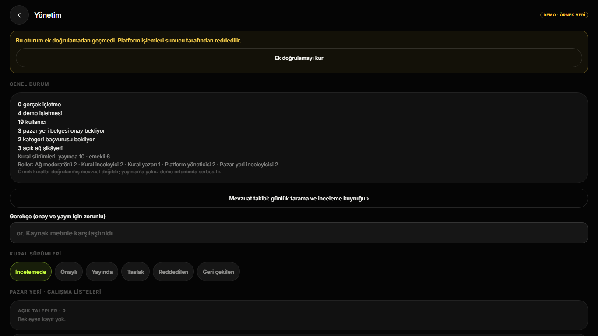
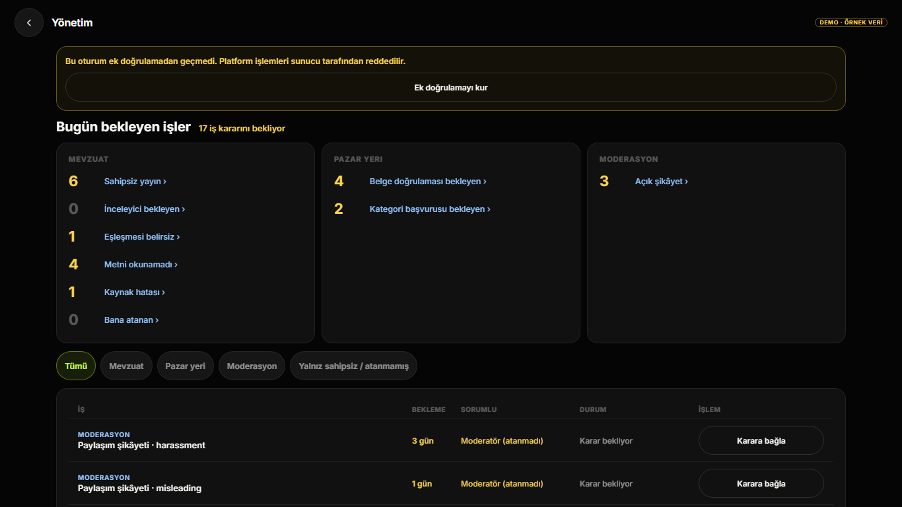

# Platform yöneticisi ana sayfası (/admin) — teslim notu

Kapsam: yalnız `/admin` ve oradan açılan mevcut iş listeleri (mevzuat masası, pazar yeri listeleri, moderasyon). Tüm veri SENTETİK / örnek.

## Çalışan yerel adres

- Arayüz: `http://localhost:8100/admin` (API `http://localhost:3078`, veri tabanı `gh_acc2`).
- Giriş: `tum-roller.t9@demo.goverhub.test` (tüm roller). Sınırlı hesaplar: `yonetici@`, `pazar@`, `moderator@`, `yazar@` (`@demo.goverhub.test`). Kod, giriş ekranındaki “Demo kutusundan kodu getir” ile alınır.

## Önce / sonra (1366×768)

| Önce | Sonra |
| --- | --- |
|  |  |

1440×900 karşılıkları aynı klasörde (`t9-once-1440.png`, `t9-sonra-1440.png`).

## Ne yapıldı

- `GET /admin/work` (yeni): alan başına durum `ok | forbidden | error`, sayaçlar (her biri saydığı kayıtları açan süzgeçli bağlantı taşır), satırlar (bekleme süresi, sorumlu, durum, işlem, bağlantı), `missing` listesi. Sunucu: `server/src/services/admin-work.ts`.
- Ana sayfa: `mobile/src/features/AdminHome.tsx`. Mevzuat masası ana sayfadan doğrudan açılır (`/legislation`, sayaç bağlantıları `?quick=`, `?health=1`, `?sel=`).
- Pazar listeleri `/admin?list=verifications|authorizations`, moderasyon `/moderation?status=open` süzgeçle açılır.
- Rol ayrımı: mevzuat = platform yöneticisi / kural yazarı / kural inceleyici; pazar = pazar yeri inceleyicisi; moderasyon = ağ moderatörü. Yetkisiz alan “yetki yok”, yüklenemeyen alan “yüklenemedi (bekleyen iş yok demek değildir)”, yetkili ama boş alan “bekleyen iş yok” diye ayrı gösterilir.

## Hesaplanamayan sayaçlar (eksik olarak kayıtlı)

- Pazar yeri başvurusunda sorumlu kişi — başvurular kişiye atanmıyor; satırda rol adı yazılır.
- Şikâyette sorumlu moderatör — şikâyetler kişiye atanmıyor; satırda rol adı yazılır.
- Pazar yeri hizmet şikâyetleri — bu turun kapsamı dışında, sayılmıyor.

## Üç kabul sorusu (1366×768 ve 1440×900, `kanit-admin-ana-sayfa/t9-accept.cjs`)

1. **Giriş sonrası bugün hangi iş bekliyor anlaşılıyor mu?** Evet. İlk ekran “17 iş kararını bekliyor” der; alan kartları sayaçları (mevzuat 6/0/1/4/1/0, pazar 4/2, moderasyon 3) ve altında bekleme süresi, sorumlu, durum, işlem sütunlu en eski önce sıralı tablo vardır.
2. **Sayıya tıklayınca tam o kayıtlar mı açılıyor?** Evet. 9 sayacın 9’unda sayaç = açılan listedeki kayıt sayısı (mevzuat 6/0/1/4/1/0, belge 4, kategori 2, şikâyet 3), aynı süzgeçle.
3. **Kayıt işlenip dönünce sayı güncelleniyor ve süzgeç korunuyor mu?** Evet. Mevzuat + “yalnız sahipsiz” süzgeci açıkken bir yayın reddedildi; masadan dönünce sahipsiz sayacı 6 → 5, işlenen satır listeden kalktı, alan ve sahipsiz süzgeci korundu. Pazarda belge sayacı 4 → 3.

Rol ayrımı (sınırlı hesaplar): `yonetici@` yalnız mevzuatı görür (pazar ve moderasyon “yetki yok”); `moderator@` yalnız moderasyonu; `pazar@` yalnız pazar yerini. Sunucu testi (`gh18-admin-work.test.ts`) ayrıca rolsüz hesabın 403 aldığını ve bir alan yüklenemezken yalnız o alanın “hata” olduğunu doğrular.

## Notlar

- Test sayımı ilk denemede gizli (0×0) önceki ekran kopyalarını ve `ver-approve-why` ipucu öğelerini saydı; seçici düzeltildi, ürün davranışı doğruydu.
- Bu ortamda “ek doğrulama” uyarısı görünür (`MFA_REQUIRED_FOR_PLATFORM=false` demo ayarı); ana sayfa akışını etkilemez.
